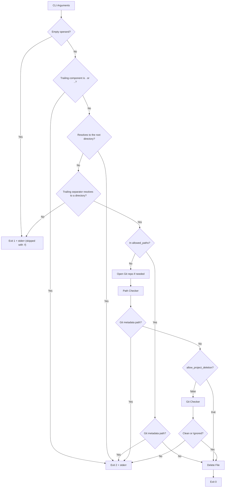
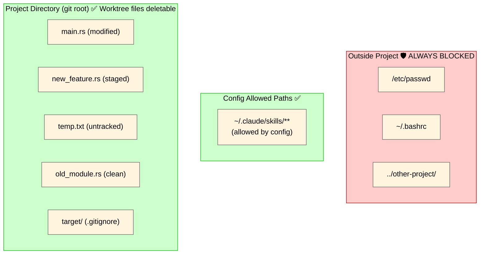
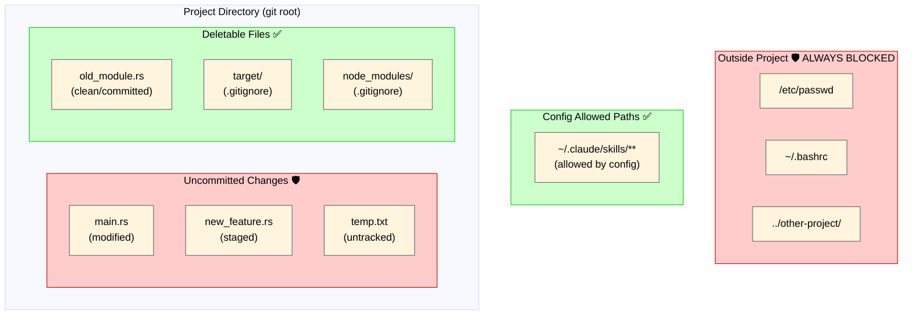
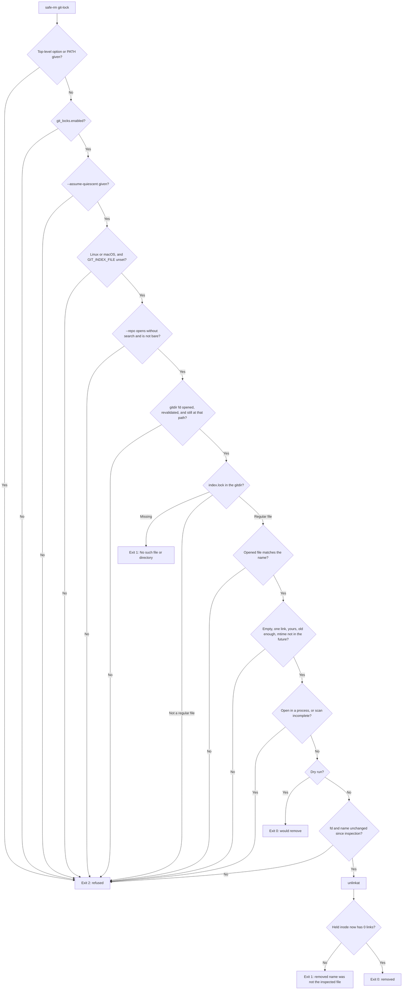

# Architecture

How `safe-rm` decides whether a path can be deleted: the order of the checks, the safety layers, and what each mode lets an agent delete. The separate `git-lock` subcommand, which can remove an empty `index.lock`, has its own section: [The `git-lock` Subcommand](#the-git-lock-subcommand). Back to the [README](../README.md).

## Safety Layers

1. **Git Metadata Protection**: Direct `.git` targets, gitdir indirection files, bare-repository administrative paths, and the current repository's metadata are always blocked. Recursive deletion containing nested Git metadata is blocked by default and reports every metadata path. For one ignored directory operand, `--allow-nested-git GIT_PATH` can explicitly name each nested metadata directory (including a bare repository root); every entry must be named before deletion begins. Gitdir files and symlinks cannot be opted in. Bare repositories are detected by their structure markers (`HEAD` entry, `objects/`, `refs/`), so a bare repository with a corrupted `config` (where `Repository::open_bare()` fails) is still protected fail-closed. If a recursive metadata scan cannot read a directory entry, deletion is blocked fail-closed.
2. **Path Containment**: Ensures all non-`allowed_paths` paths resolve within the project directory (Git repository root, or cwd if not a Git repo) before recursive metadata scanning. For nonexistent targets, it canonicalizes the nearest existing parent to absorb alias differences (e.g. repo symlink alias, `/var` vs `/private/var`). Both the deletion entry (the trailing component, without following a trailing symlink) and the fully resolved target must lie inside the project, so an outside symlink pointing into the project (entry is outside) and an inside symlink pointing outside (target is outside) are both blocked; the same two-position check applies to `allowed_paths` matching.
3. **Git Protection**: When `allow_project_deletion = false`, blocks deletion of dirty files (modified/staged/untracked), including files nested under untracked directories. Status is evaluated using the Git repository that actually owns the target — both the cwd-side discovery and a discovery from the target itself are tried, and the deepest workdir containing the target is selected, so cross-repository deletions (cwd non-Git but target inside a nested Git repo, cwd repo ignoring a nested repo, or cwd and target belonging to different repos) are still checked fail-closed
4. **Recursive Check**: For real directories, validates all contained files. Ignored descendants remain deletable, but ignored parent directories do not hide tracked modified/staged files or untracked siblings
5. **Fail-Closed**: Any directory read failure (including entry iteration errors), target metadata classification failure, Git API error from `Repository::discover()` on non-`allowed_paths` deletion paths (e.g. corrupted `.git`, permission errors, I/O failures), worktree canonicalization failure, unreadable metadata probe while classifying a `NotFound`, an unresolvable intermediate symlink, or config location/read/parse error blocks deletion or falls back to strict mode. `NotFound` is treated as non-Git only when no `.git`/bare-repository ancestor is found and the ancestor probe itself succeeds. `allowed_paths` still enforce Git metadata protection, but they do not require current-directory Git discovery to succeed
6. **Unsafe Parent Traversal Guard**: Reject paths whose `..` would collapse a component that is not a real directory before deletion. Patterns such as `link/../victim` (symlink), `missing/../victim` (non-existent), `file/../victim` (regular file), and any component whose metadata cannot be read (permission denied, special file) are rejected fail-closed, preventing lexical normalization from silently retargeting a different on-disk file. Paths below a dangling intermediate symlink are also rejected before deletion, while deleting the dangling symlink entry itself remains allowed
7. **Alias-Path Hardening**: Path containment and `allowed_paths` matching canonicalize the nearest existing parent and reattach missing segments, while Git checks canonicalize non-symlink paths and only parent directories for symlink paths, to avoid alias-based bypasses (e.g. repo symlink alias, `/var` vs `/private/var`)
8. **`.` / `..` Operand Rejection**: Operands whose trailing component is `.` or `..` are rejected with exit code 2 before any normalization, `allowed_paths` matching, or `-f` handling, mirroring POSIX `rm`, which refuses to remove `.` or `..` directories. Name the directory explicitly (`safe-rm -r sub`) instead. Dot-prefixed filenames such as `.hidden` and `...` are unaffected
9. **Empty-Operand Rejection**: An empty operand is rejected as `No such file or directory` (exit 1) before the `.` / `..` check, because `cwd.join("")` equals `cwd` and would otherwise let `-r ""` delete the working directory. Under `-f` it is silently ignored, as `rm` does
10. **Shared Metadata Read per Target**: The `allowed_paths` decision, the `-r` requirement, and the removal method all share one and the same `symlink_metadata()` result. Reading it twice would let a file-to-directory swap between the two reads turn a target approved as "a direct child of a non-recursive allowed entry" into a `remove_dir_all` of its whole subtree. (The trailing-separator check below runs earlier and uses a separate `metadata()` call, which only decides whether the raw operand resolves to a directory and never feeds the removal method.)
11. **Root-Operand Rejection**: Operands that resolve to the root directory (`/`, `//`, or `.` when the working directory is `/`) are rejected with exit code 2, mirroring POSIX `rm` and GNU `rm`'s `--preserve-root` (enabled by default). Without this, a working directory of `/` in a non-Git environment (for example a container running as root) would make the project root `/`, so containment passes and Git metadata protection does not cover `/` itself
12. **Trailing-Separator Operand Validation**: A trailing separator is a POSIX request that the operand be a directory, so `rm` does not remove operands that fail to resolve as one. Because normalization strips the trailing separator, `file.txt/` would otherwise become a deletion of `file.txt` itself and `danglink/` (a broken symlink) a deletion of the link entry. The raw operand is resolved before normalization: non-directories yield `Not a directory` and unresolvable paths yield `No such file or directory` (both exit 1, silently ignored under `-f` just as GNU `rm` does; BSD/macOS `rm -f` ignores only `ENOENT`), while `ELOOP` and permission failures propagate as I/O errors even under `-f`. Symlinks to directories still resolve as directories, so `link/` keeps removing only the link entry and leaves the target intact. This check runs after the dangling-intermediate-symlink guard, so a path below an unresolvable intermediate symlink (`dangling/child/`) is still blocked with exit code 2 and is not ignored by `-f`
13. **Spelling-Insensitive Strict Checks**: On case- or normalization-insensitive filesystems (macOS APFS, Windows NTFS), `SRC` still deletes `src` and an NFD-spelled name still deletes the NFC-spelled file (or vice versa), while Git status keys use the on-disk spelling (precomposed to NFC on macOS through `core.precomposeunicode`). Before the Git check, strict mode aligns the target with its on-disk spelling — non-symlinks are canonicalized down to the final component, and symlinks keep the link but take the name of the directory entry with the same device and inode (matching by name would confuse `my_link` with `MY_LINK` on case-sensitive filesystems; when no single entry has that inode — the entry changed during the check, or the symlink itself is hard-linked — the deletion is blocked fail-closed). On macOS the status cache also registers the NFD form of every non-ASCII key and lookups retry with the NFD form of the target, so canonically equivalent names always match (both sides are decomposed because standard NFC maps CJK compatibility ideographs that git's precomposition leaves alone); colliding aliases keep the non-deletable status. When scanning a directory for uncommitted deletions, `core.ignorecase` repositories compare keys ASCII case-insensitively, as Git does. Exact matches are always tried first, so a different file on a case- or normalization-sensitive filesystem is never mistaken for the target
14. **Separate Recovery Path for `index.lock`**: Normal deletion makes no exception for Git metadata. When the target is the `index.lock` directly inside a gitdir (a directory that has `HEAD`), the error shows the `safe-rm git-lock` command to run instead, in the `allowed_paths` branch as well. This is guidance only; nothing is removed. `git-lock` has its own checks, described in [The `git-lock` Subcommand](#the-git-lock-subcommand)

## File System and Deletable Scope

### Default Mode (`allow_project_deletion = true`)

| File | Deletable | Reason |
|------|-----------|--------|
| `old_module.rs` (clean) | ✅ Yes | Inside project |
| `target/` (ignored) | ✅ Yes | Inside project |
| `main.rs` (modified) | ✅ Yes | Inside project (allow_project_deletion=true) |
| `temp.txt` (untracked) | ✅ Yes | Inside project (allow_project_deletion=true) |
| `~/.claude/skills/foo` | ✅ Yes | Allowed by config (recursive) |
| `.git/` | ❌ No | Git administrative metadata is always protected |
| `.git/index.lock` | ❌ No | Git administrative metadata; only `safe-rm git-lock` can remove an empty lock |
| `./` or repo root with `-r` | ❌ No | Recursive deletion would include Git administrative metadata |
| `/etc/passwd` | ❌ No | Outside project directory |
| `../other-project/` | ❌ No | Path traversal blocked |

### Strict Mode (`allow_project_deletion = false`)

| File | Deletable | Reason |
|------|-----------|--------|
| `old_module.rs` (clean) | ✅ Yes | Committed, recoverable via `git checkout` |
| `target/` (ignored) | ✅ Yes | In `.gitignore`, build artifacts |
| `node_modules/` (ignored) | ✅ Yes | In `.gitignore`, dependencies |
| `~/.claude/skills/foo` | ✅ Yes | Allowed by config (recursive) |
| `.git/` | ❌ No | Git administrative metadata is always protected |
| `.git/index.lock` | ❌ No | Git administrative metadata; only `safe-rm git-lock` can remove an empty lock |
| `./` or repo root with `-r` | ❌ No | Recursive deletion would include Git administrative metadata |
| `main.rs` (modified) | ❌ No | Uncommitted changes would be lost |
| `new_feature.rs` (staged) | ❌ No | Pending commit would be lost |
| `temp.txt` (untracked) | ❌ No | Not in Git history, unrecoverable |
| `/etc/passwd` | ❌ No | Outside project directory |
| `../other-project/` | ❌ No | Path traversal blocked |

**Key Points**:
- Files outside the project are **always blocked**, regardless of settings
- Git administrative metadata such as `.git` is **always blocked**, regardless of settings; this includes recursive deletion of the current repository root. Only the separate `safe-rm git-lock` subcommand can remove an `index.lock`, and only an empty one under its own conditions
- **Default mode (`allow_project_deletion = true`)**: Worktree files inside the project can be deleted (ideal for AI agents)
- **Strict mode (`allow_project_deletion = false`)**: Only clean (committed) or ignored worktree files can be deleted. Deleting a directory also rejects uncommitted deletions that no longer exist on disk (a `git rm`-staged or worktree-deleted tracked file under it), since those are detected via the Git status cache rather than `read_dir`
- **Config allowed paths** bypass containment and Git-status checks, but not Git metadata protection (supports `~` expansion)

## Git Status Decision Matrix

### Default Mode (`allow_project_deletion = true`)

| File Status | Deletable? | Reason |
|-------------|------------|--------|
| Any (inside project) | Yes | `allow_project_deletion = true` skips Git checks |
| Outside project | No | Always blocked regardless of settings |

### Strict Mode (`allow_project_deletion = false`)

| File Status | Deletable? | Reason |
|-------------|------------|--------|
| Clean | Yes | Committed and recoverable via `git checkout` |
| Modified | No | Uncommitted changes would be lost |
| Staged | No | Pending commit would be lost |
| Untracked | No | Not in Git history, unrecoverable |
| Ignored | Yes | Build artifacts, not source controlled |
| Outside project | No | Always blocked regardless of Git status |

**Note**: A non-Git current directory does not disable strict checks. `safe-rm` also discovers a repository from each deletion target and selects the deepest worktree containing it. Git status checks are skipped only when the target itself is not in a Git repository; discovery and worktree-resolution errors fail closed.

## The `git-lock` Subcommand

Normal deletion protects Git metadata without exception. `safe-rm git-lock` is a separate recovery command: given an explicit quiescence assertion, and only after additional checks pass, it removes an empty `index.lock` directly inside a gitdir. The checks do not prove that the lock is abandoned. git can hold a lock without keeping it open, and some processes are invisible to safe-rm, so the checks only add reasons to refuse. That no git process is running is something the caller asserts with `--assume-quiescent` on every run.

### Check Order

1. **Mixed options**: Top-level `-r`, `-f`, `-n`, or `--allow-nested-git`, or a PATH operand, is refused. A dry run uses the `-n` given after `git-lock`.
2. **Config**: Refused when `[git_locks] enabled = false`, which includes the fail-closed fallback for a config that cannot be located, read, or parsed. `allowed_paths` and `allow_project_deletion` are not consulted.
3. **Quiescence assertion**: Refused without `--assume-quiescent`.
4. **Platform**: Refused on anything other than Linux and macOS, including Windows.
5. **Alternate index**: Refused while `GIT_INDEX_FILE` is set, even to an empty string. With an alternate index, the `index.lock` in the gitdir is not necessarily that index's lock.
6. **Repository**: `--repo` is opened with `Repository::open_ext(path, NO_SEARCH, [])`, which neither searches parent directories nor reads environment variables such as `GIT_DIR`. A path that does not open as a repository is refused, and so is a bare repository. The gitdir (`repo.path()`) is then canonicalized and fixed; for a linked worktree or a submodule, it is that worktree's or submodule's own gitdir.
7. **Lookup by name**: The gitdir is opened with `O_DIRECTORY | O_NOFOLLOW`, and its fd is kept. `--repo` is then resolved again, and it must yield the same gitdir, whose path must still refer to the directory held by the fd. This refuses a gitdir that was replaced by another directory between the first resolution and the open. It does not catch a replacement that is put back while the re-check runs; that is covered by the quiescence assertion (see the last section). `fstatat(..., AT_SYMLINK_NOFOLLOW)` examines `index.lock` relative to that fd. A missing lock ends with `cannot remove '<path>': No such file or directory` (exit 1). Anything other than a regular file (symlink, directory, FIFO, socket, device) is refused without being opened.
8. **Open**: The lock is opened with `openat(O_RDONLY | O_NOFOLLOW | O_NONBLOCK | O_CLOEXEC)`, and `fstat` on the new fd must match the name-side result.
9. **Attributes**: The lock must be a regular file of size 0 with one link, owned by the effective user, and last modified no later than now and at least `min_age_secs` ago. Only an empty lock qualifies, because a lock with content may hold a new index that git has not committed yet. When the lock is too recent, the message says how many more seconds to wait.
10. **Open-handle scan**: Refused when a process has the lock open or the scan is incomplete (see below).
11. **Dry run**: With `-n`, the command succeeds here (exit 0) without removing anything.
12. **Re-check**: Just before removal, both the held fd and the name are examined again. Device, inode, mode, size, link count, owner, mtime, and ctime must all match the inspected values; any difference is refused, with no retry.
13. **Removal**: `unlinkat(dirfd, "index.lock", 0)`. A failure is an I/O error (exit 1).
14. **Confirmation**: The held inode must now have a link count of 0. Otherwise the removed name was not the inspected file, and the command exits with 1.

The lock's fd stays open from step 8 to the end. While it is open, the inode cannot be freed and reused by another file that would then pass the re-check with the same device and inode numbers.

### What the Open-Handle Scan Covers

The scan matches device and inode numbers, not paths. It ends in one of three results: a process was found, none was observed, or the scan was incomplete. Only "none observed" lets the removal continue.

- **Linux**: Every fd under `/proc/<pid>/fd` is `stat`ed. Only processes whose `/proc/<pid>` is owned by the effective user are scanned (every process when running as root). Non-dumpable processes such as `ssh-agent` appear as root-owned and are therefore skipped. If the fds of a same-owner process cannot be read, the scan is incomplete. Following `/proc/<pid>/fd/<n>` requires the kernel's ptrace read check, which a same-owner process can still fail, for example when it runs with a different group or is confined by an LSM; the message then names the process and its credentials. Such a process is not skipped, because it may still work on the user's repository, so `git-lock` refuses on systems that have one (this was observed on a GitHub Actions Linux runner).
- **macOS**: libproc (`proc_listallpids` → `proc_pidinfo` → `proc_pidfdinfo(PROC_PIDFDVNODEINFO)`) gives the device and inode of each vnode fd. Only processes running as the effective user are scanned (every process when running as root). The PID list and the fd lists are re-read with larger buffers when they fill up; if they still do not fit, the scan is incomplete. A vnode fd whose details are unavailable (`ENOENT`) is skipped and counted. When the OS denies fd inspection (`EPERM`), the process is skipped only if it is an Apple platform binary (`CS_PLATFORM_BINARY` from `csops`) whose executable name is neither `git` nor `git-*`. Its start time is compared before and after this classification, and a reused PID makes the scan incomplete. In practice these are OS daemons running as the same user, such as `/usr/libexec/routined`, `lsd`, `nsurlsessiond`, and `UserEventAgent`. Any other `EPERM` makes the scan incomplete. Skipped processes and fds are reported on the `safe-rm: note:` line.
- After a process that cannot be inspected, the scan still goes on, and a process found holding the lock is reported instead of the incomplete scan.
- In its own process, safe-rm skips only the fd it opened for the inspection.
- A scan that takes longer than 10 seconds counts as incomplete, even if it reaches the end.

### What the Scan Cannot See

- processes of other users, unless safe-rm runs as root
- processes in another PID namespace, such as a container
- processes on another host that shares the repository over a network file system
- a git process that holds the lock without an open fd, for example `git commit` waiting for the editor

These gaps are why `--assume-quiescent` is required on every run and cannot be set in the config file.

### Races the Checks Cannot Close

safe-rm cannot prevent a replacement between the re-check and the removal. The re-check (step 12) and `unlinkat` (step 13) are separate system calls. If another process replaces `index.lock` between them, `unlinkat` removes the replacement. Step 14 detects this afterwards and exits with 1 when the inspected file still has another name (it was renamed away), but not when it was already removed; in neither case can the removal be undone.

The gitdir check in step 7 has a similar limit. The first resolution, the re-resolution, and the comparison with the held fd each resolve the path separately, so a process that swaps the gitdir and puts it back between them is not detected. For both races, the quiescence assertion covers changes made by anything other than git: until the removal finishes, nothing may modify or replace the gitdir, the directories on its path, or `index.lock`. Like normal deletion, these checks do not defend against a concurrent process that deliberately rearranges paths while safe-rm runs.
